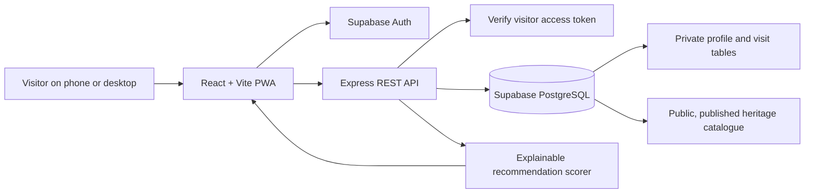

# Eternal Heritage — Product & Software Engineering Brief

## 1. Problem statement

Digital heritage information is fragmented across articles, photo galleries, videos and institutional websites. First-time visitors may see a monument without understanding its context, while blind visitors may not receive an equivalent understanding of visual features from image-led pages. Visitors also arrive with different languages, interests and knowledge levels, yet many sites provide the same content order to everyone.

**Eternal Heritage** is an accessibility-first, personalised heritage discovery platform. It provides one shared experience for sighted and blind visitors, supports source-linked heritage stories, and uses explicit user preferences to rank relevant stories and destinations.

## 2. Users and needs

- **First-time heritage visitor:** needs concise context, a clear route through the content and reliable sources.
- **Blind visitor or screen-reader user:** needs semantic headings, meaningful image descriptions, keyboard-operable controls and content that does not depend on seeing an image.
- **Interest-led explorer:** wants the heritage collection connected to topics such as cooking, architecture, sculpture, history, mythology, festivals, crafts, photography or visual storytelling.
- **Regional explorer:** wants relevant destinations in their own state or territory, not only famous sites elsewhere.
- **Content reviewer (future admin role):** needs a way to check claims and sources before new stories are published. Release 1 uses explicit database review fields; it does not yet include an admin dashboard.

## 3. Release 1 scope

### Included

1. Email/password registration and sign-in via Supabase Auth.
2. Profile fields: name, broad age band, state/territory, interests, preferred language, and an optional recently visited heritage site.
3. Profile and visit persistence in PostgreSQL, protected by Row Level Security (RLS).
4. Source-linked heritage-site and story catalogue.
5. Explainable rule-based recommendations using selected interests, regional relevance, the optional recent visit and recorded visits.
6. A mobile-responsive React UI with keyboard-visible focus, semantic structure, meaningful alt text, reduced-motion handling and a PWA manifest/build configuration.
7. Profile editing, sign-out, mark-as-visited and account deletion route.

### Explicitly deferred

- Recommendation pop-ups or push notifications.
- Retrieval-Augmented Generation (RAG) / AI question answering.
- Admin content-management interface.
- Full translated content and spoken audio-description library.
- Public hosting, production monitoring and a complete offline library.

The language field in Release 1 is a saved preference; the full content is currently authored in English. This is documented so the interface does not falsely claim that translations are complete.

## 4. Architecture

- **Frontend:** React + Vite. Handles profile form, sign-in, story cards, recommendation reasons, site details and responsive presentation.
- **Authentication:** Supabase Auth manages passwords and sessions. The application does not store raw passwords.
- **API:** Node.js + Express validates profile values and visits. Protected endpoints require a verified Supabase user access token.
- **Database:** PostgreSQL in Supabase. A signup trigger copies validated-form metadata into the profile row; RLS limits profile/visit reads and writes to the authenticated owner.
- **Editorial boundary:** public API queries return published sites and only stories marked both published and verified. New content should remain unpublished until a human checks the source and the claim.

## 5. Recommendation logic

Each story receives a transparent score. The initial implementation uses:

| Signal | Initial weight |
|---|---:|
| Each matching interest tag | +4 |
| Story/site is relevant to the selected state | +8 |
| Story is connected to the recent visit | +5 |
| Cooking interest plus Tirumala food story | +5 additional |
| Anime interest plus a story explicitly tagged for visual storytelling | +3 additional |
| Previously visited destination (except the recent visit) | −2 |

The system sorts by score and returns the top six stories, each with an explanation of the match. Weights are transparent starting points, not a claim of machine-learning accuracy; they should be adjusted after user testing.

Examples covered by tests:

- **Cooking + Tirumala:** the laddu story ranks highly and links to a TTD publication describing the materials used at production scale. It is not misrepresented as an exact home recipe.
- **Telangana + Tirumala:** a Yadagirigutta story offers a regional pilgrimage comparison and explicitly says that the two temples have different traditions.
- **Anime / visual storytelling:** temple sculpture is used as a way to discuss motifs and narrative visual design. The content explicitly says this is an analogy, not a historical connection between anime and the temple.

## 6. Data minimisation and safety

- Collect a broad age band rather than an exact date of birth.
- A state/territory is selected by the user. The application does not request GPS coordinates or track live location.
- Interest preferences and visit history are used to rank heritage stories; profile storage is disclosed during registration.
- A user can edit their profile, sign out or request account deletion.
- Only Supabase's publishable key belongs in browser environment variables. Never expose a Supabase secret/service-role key.
- Before a public deployment—especially one used by minors—complete a privacy/security review, add suitable age/guardian-consent handling where required, and test deletion and account recovery end-to-end.
- Do not collect real user data in a class demo unless the project owner has configured the privacy notice and database policies appropriately.

## 7. Evaluation plan for a Software Engineering review

| Area | Evaluation method | Minimum acceptance criterion |
|---|---|---|
| Registration | Create account with valid fields and confirm email if enabled | Auth account and matching profile row exist |
| Profile access control | User A attempts to read/update User B's profile | Access is denied by RLS |
| Profile edit | Change state or interests, save and reload | Updated values persist after sign-in |
| Personalisation | Run the three scripted scenarios above | Expected story appears near the top with a reason and source |
| Visit history | Mark a site as visited, reload and revisit recommendations | Visit persists and affects ranking |
| Source integrity | Open each story's source link and check claim | Claim is supported by a relevant institutional/authoritative source |
| Accessibility | Keyboard-only and screen-reader walkthrough | Navigation, labels, focus and story content remain understandable without a mouse or image perception |
| Responsive use | Test phone-width layout and LAN preview | No horizontal overflow; controls remain usable |
| Account deletion | Use a disposable account | Auth account and cascading private data are deleted |

The included automated tests cover the three core recommendation scenarios. Manual end-to-end tests against a configured Supabase project remain necessary before a project demonstration or public deployment.

## 8. Suggested professor demo flow

1. Explain the problem using the same-website-for-everyone limitation and the need for accessible, source-based heritage storytelling.
2. Register a demo account with the interest **Food & cooking**, state **Andhra Pradesh** or **Telangana**, and recent visit **Tirumala**.
3. Show the laddu story, its explicit match reason, and its TTD source link.
4. Edit the profile to **Telangana**, choose temple-related interests, and show a regional Yadagirigutta recommendation.
5. Edit the interest to **Anime & visual stories**, then explain that the recommendation makes a modern visual-storytelling analogy without claiming a historical relationship.
6. Mark a destination as visited, reload, and demonstrate that visit history persists.
7. Briefly show the schema and RLS policies, then run the recommendation tests.
8. End with the accessibility plan and future releases (translations, audio descriptions, RAG and recommendation pop-ups).

## 9. Current implementation status

This is a local Release 1 scaffold, not a deployed production service. It must be connected to a new Supabase project using the bundled SQL and environment files. The backend syntax checks, frontend JSX parse check and three recommendation unit tests pass in the build workspace. A complete Vite production build was not verified there because dependency installation timed out; run the documented install/build commands on the development computer and test the full registration flow with a configured Supabase project.
